<h1 align="center">NL SQL Analyst</h1>

<p align="center">
  <em>A natural-language-to-SQL analyst powered by a plugged-in language model, with read-only guardrails and result verification. Questions become SQL that is validated before it runs and executed against a real SQLite database.</em>
</p>

<p align="center">
  <a href="https://github.com/adeoluo/nl-sql-analyst/actions/workflows/ci.yml"></a>
  
  
  
  
  
</p>

---

## Motivation

Letting a language model write SQL against a real database is useful and dangerous: useful because
anyone can ask a question in plain English, dangerous because a wrong or malicious query can read
data it should not or modify it. The safe design puts **guardrails between the model and the
database**: the generated SQL is validated to be a single read-only query, scoped to known tables
and columns, and bounded, before it is ever executed. This project implements that analyst from
scratch, with **zero third-party dependencies** (the database is the standard-library ``sqlite3``),
so generated SQL runs for real and the guardrails are tested against an actual engine.

The model sits behind a provider interface. An offline keyword translator powers tests and CI, so
everything is reproducible with no credentials; a **real Claude provider**, built on the standard
library, powers production.

## Architecture

<p align="center">
  
</p>

A question is combined with the schema into a prompt; the provider returns SQL; the guardrails
validate it; only if it is safe is it executed against the in-memory database; and the result is
returned with its columns. The same pipeline runs against a labeled benchmark to measure accuracy.
See the [ADRs](docs/adr/) for the key decisions.

## What it implements

- **Read-only guardrails** - the SQL must be a single ``SELECT``, with no banned keywords (insert,
  update, delete, drop, alter, pragma, and more), referencing only known tables and columns, and is
  capped with a ``LIMIT``. Validation happens before execution.
- **Real execution** - queries run against a seeded in-memory SQLite database, so results are
  genuine and the guardrails face an actual SQL engine.
- **Result verification** - the result's columns and rows are returned and checked against reference
  answers in the benchmark.
- **A provider interface** - an offline keyword translator for CI, and a Claude provider for
  production.

## Results

> Reproduce with `python -m nl_sql_analyst evaluate`. Each benchmark question has a reference SQL
> whose execution defines the correct answer; the analyst is scored on matching it. Unsafe SQL
> strings check the guardrails.
>
> These numbers come from the deterministic offline translator and are reproduced by the test suite in continuous integration (no network, no credentials). In production the provider is Claude behind the same interface, which is where the joins, subqueries, and ranking the offline translator misses are handled; the read-only guardrails apply to its SQL regardless.

| Metric | Value |
|---|---:|
| **answer accuracy** | **0.750** (9/12) |
| **guardrail block rate on unsafe SQL** | **1.000** (8/8) |

The offline translator answers **9 of 12** questions correctly (counts, averages, filters, and
ranking by a single column) and misses exactly the three that need a **join, a subquery, or
top-N ranking** - which is what the production model is for. The guardrails block **every** unsafe
query (drops, deletes, updates, inserts, multi-statement injection, unknown tables, schema changes),
independent of what the model returns.

### Scale

To check that the pipeline holds up under volume, `benchmarks/scale.py` runs growing synthetic
query streams (sampled from the labeled benchmark) through the full `Analyst.ask` pipeline -
translate, guardrail, execute - and through the guardrail on unsafe queries, reporting throughput
and peak memory (via the standard-library `tracemalloc`) alongside answer accuracy and the block
rate. The data is synthetic and the numbers are environment-specific; because each ask builds and
tears down its own in-memory database, throughput and memory are constant in the workload size,
and accuracy and block rate match the labeled benchmark.

| Queries | Wall-clock (s) | Throughput (queries/s) | Peak memory (MiB) | Accuracy | Block rate |
|---:|---:|---:|---:|---:|---:|
| 500 | 1.05 | ~477 | 0.11 | 0.738 | 1.000 |
| 1,000 | 1.86 | ~539 | 0.04 | 0.751 | 1.000 |
| 2,000 | 3.71 | ~539 | 0.01 | 0.751 | 1.000 |
| 4,000 | 7.67 | ~522 | 0.01 | 0.748 | 1.000 |

Answer accuracy holds near 0.75 and the guardrail block rate stays 1.000 across sizes, matching the
twelve-question benchmark. The accuracy comes from the deterministic offline translator; production
uses a real language-model API behind the same interface, which is where the joins, subqueries, and
ranking the offline translator misses are handled. Reproduce with `uv run python benchmarks/scale.py`.

## Demonstration

```text
$ python -m nl_sql_analyst ask "What is the average salary in Engineering?"
status: ok
sql:    SELECT AVG(salary) FROM employees WHERE department = 'Engineering' LIMIT 1000
  (151666.66666666666,)

$ python -m nl_sql_analyst check "DROP TABLE employees"
safe: False
reasons: not_a_select, banned_keyword:drop, unknown_identifiers:drop,table
```

## Using a real model in production

```python
from nl_sql_analyst import Analyst, AnthropicProvider

analyst = Analyst(provider=AnthropicProvider())  # reads ANTHROPIC_API_KEY
result = analyst.ask("which employees earn more than the average salary?")
print(result.sql, result.rows)
```

The `AnthropicProvider` calls the Claude Messages API over HTTPS using only the standard library, so
there is still no third-party runtime dependency. The guardrails validate whatever SQL the model
returns before it runs, so a bad completion cannot damage the database.

## Quickstart

```bash
git clone https://github.com/adeoluo/nl-sql-analyst.git && cd nl-sql-analyst
make setup                      # install dev tooling + pre-commit hooks
make all                        # lint + type-check + test

python -m nl_sql_analyst evaluate                      # accuracy and guardrail block rate
python -m nl_sql_analyst ask "How many employees are there?"   # answer a question
python -m nl_sql_analyst check "SELECT name FROM employees"     # validate SQL
python -m nl_sql_analyst schema                        # print the schema
python -m nl_sql_analyst serve                         # start the HTTP service on :8000
```

## HTTP service

A standard-library HTTP service answers questions through the guardrails. The routing logic is a
pure function, tested without a socket. Under a concurrent stress benchmark
(`uv run python benchmarks/stress.py`, 3000 requests, 8 workers) the `/ask` handler sustains roughly
**370 requests/second** at **p50 18 ms** (each request rebuilds the in-memory database).

| Method | Path | Purpose |
|---|---|---|
| GET | `/health` | liveness, the active provider, and the schema |
| GET | `/ready` | readiness |
| GET | `/metrics` | per-route request, error, and latency metrics (Prometheus text) |
| POST | `/ask` | body `{"question": str}`; the SQL and verified result rows |
| POST | `/check` | body `{"sql": str}`; whether the SQL passes the guardrails |
| GET | `/evaluate` | answer accuracy and guardrail block rate on the benchmark |

## Design decisions

- **Validate SQL before executing it** - the model's output is never trusted; a single read-only,
  in-scope, bounded query is the only thing allowed to run. See
  [ADR 0002](docs/adr/0002-guardrails.md).
- **Execute against a real SQLite database** - using the standard-library engine means results are
  genuine and the guardrails are tested against real SQL, not a mock. See
  [ADR 0003](docs/adr/0003-real-execution.md).

## Evaluation

The database, benchmark, and offline translator are deterministic, so every number reproduces
offline. Full method and tables: [`docs/EVALUATION_REPORT.md`](docs/EVALUATION_REPORT.md).

## Responsible AI

- **Model card:** [`docs/MODEL_CARD.md`](docs/MODEL_CARD.md)
- **Data card:** [`docs/DATA_CARD.md`](docs/DATA_CARD.md)
- **Threat model:** [`docs/THREAT_MODEL.md`](docs/THREAT_MODEL.md)

## Limitations

- The offline translator is keyword-based and covers common question shapes; joins, subqueries, and
  ranking need the production model. The benchmark reports this honestly.
- The guardrails validate structure and scope, not query cost; a legitimate but expensive query is
  allowed within the row limit.
- The schema and data are a small fixed sample; a real deployment would introspect the target
  database and scope the guardrails to it.

## Roadmap

- [ ] Introspect an arbitrary database and generate the schema prompt and identifier allow-list.
- [ ] Add a query-cost estimate and a timeout alongside the row limit.
- [ ] Add column-level access control to the guardrails.

## License

[MIT](LICENSE)
